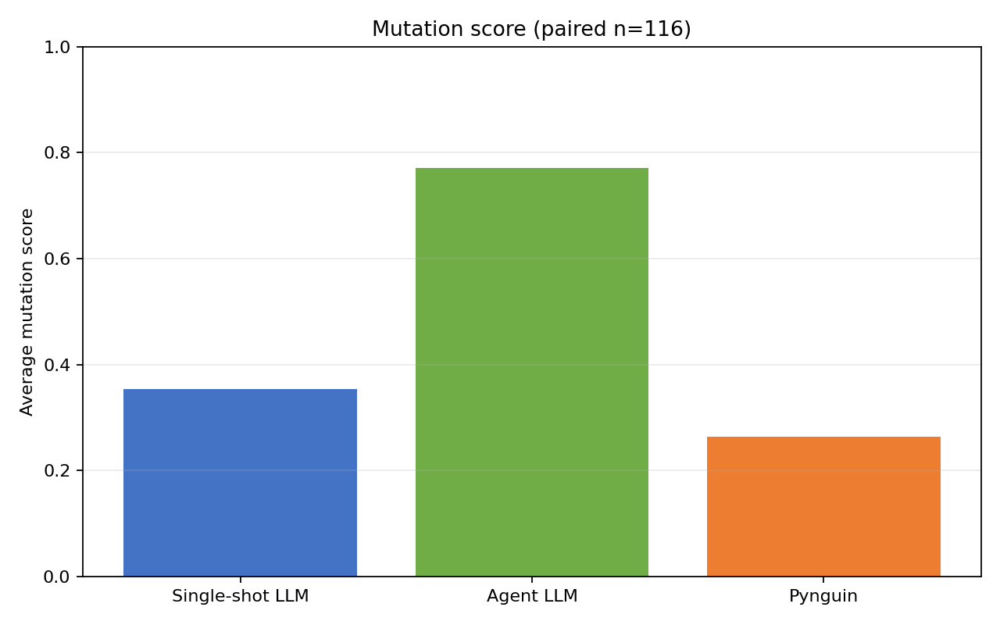
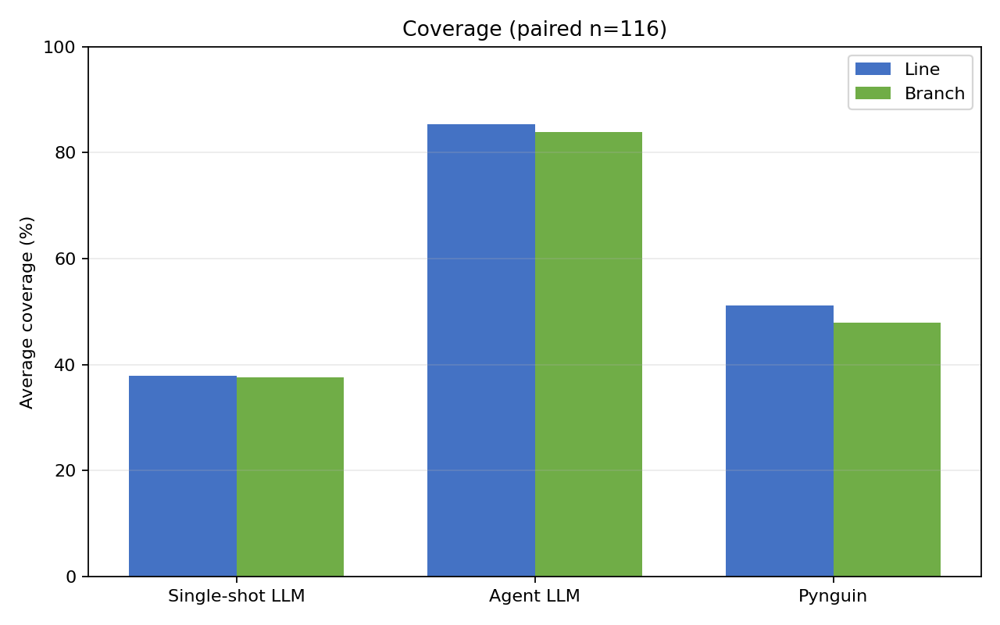
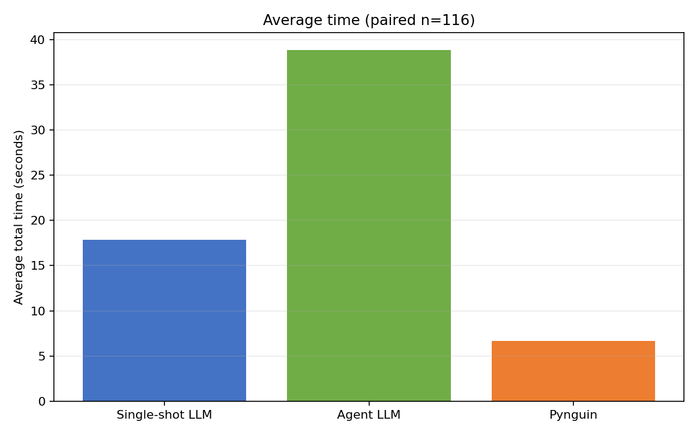

# HumanEval Full Experiment Analysis

- Source: `results/v3/humaneval_full_164_rescored.csv`
- Run date: 2026-10-30
- LLM model: qwen2.5-coder:1.5b
- Functions in CSV: 164

## Paired comparison

All engine averages below use the same complete-case functions: each of the three engines must have line coverage, branch coverage, mutation score, wrong-test count, total time, and estimated cost.

| Engine | Functions included | Avg line coverage (%) | Avg branch coverage (%) | Avg mutation score | Avg wrong tests | Avg time (s) | Avg cost (USD) |
|---|---:|---:|---:|---:|---:|---:|---:|
| Single-shot LLM | 116 | 37.82 | 37.57 | 0.3544 | 0.302 | 17.87 | 0.000000 |
| Agent LLM | 116 | 85.33 | 83.95 | 0.7718 | 0.284 | 38.83 | 0.000000 |
| Pynguin | 116 | 51.17 | 47.88 | 0.2641 | 0.000 | 6.70 | 0.000000 |

## All-functions failure counts

Counts use all functions in the CSV for each engine. Categories are independent and can overlap; `no_scorable_tests` is a scoring state, not necessarily an infrastructure failure.

| Engine | Functions | Timeout | Token-repeat | No scorable tests | Infrastructure error |
|---|---:|---:|---:|---:|---:|
| Single-shot LLM | 164 | 37 | 0 | 79 | 0 |
| Agent LLM | 164 | 42 | 0 | 16 | 0 |
| Pynguin | 164 | 4 | 0 | 66 | 0 |

## Paired Wilcoxon signed-rank tests

Two-sided tests compare mutation scores on every task with a score from both engines in that pair. The reported `n` is the number of paired tasks; p-values are unadjusted.

| Engine pair | Paired functions | Statistic | p-value |
|---|---:|---:|---:|
| Single-shot LLM vs Agent LLM | 119 | 0.0000 | 2.96835e-11 |
| Single-shot LLM vs Pynguin | 121 | 1487.0000 | 0.135412 |
| Agent LLM vs Pynguin | 116 | 161.5000 | 9.04135e-16 |

## Pynguin xfail-only suites

Pynguin produced **66** suites with at least one xfail-marked test and no passing or wrong tests.

## Charts

